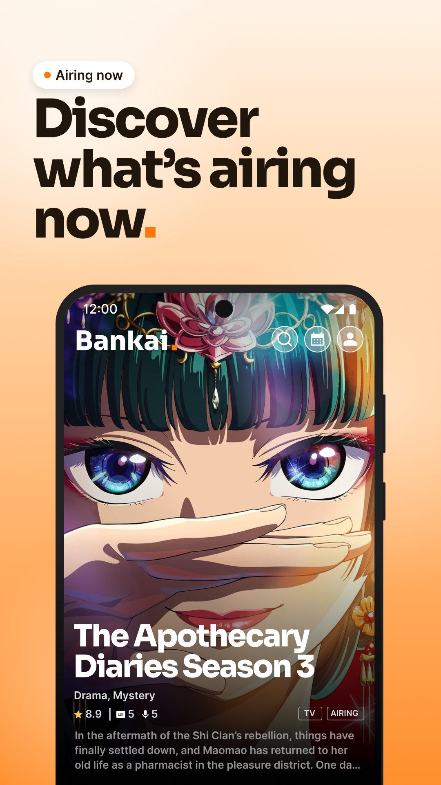
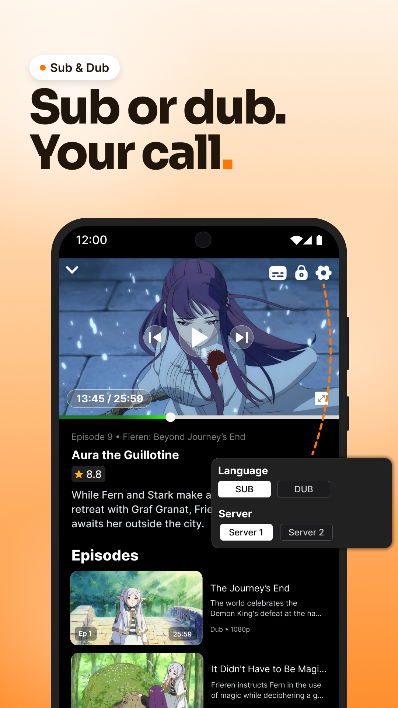
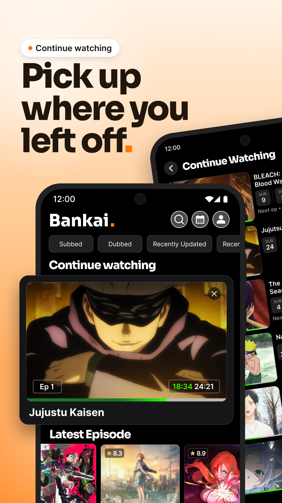
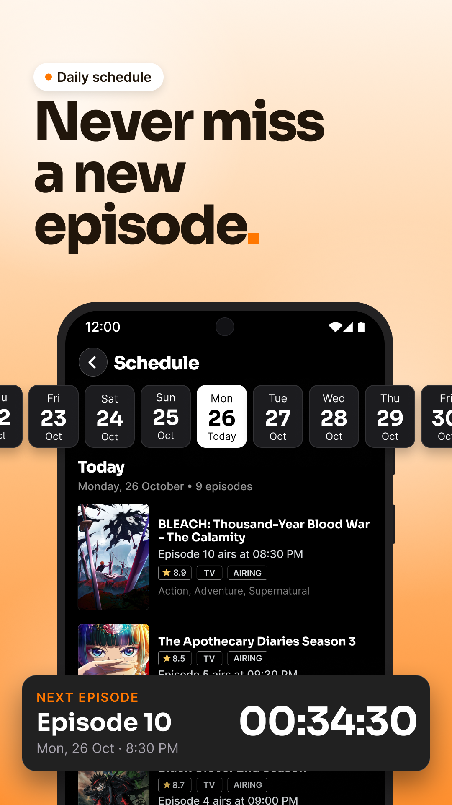
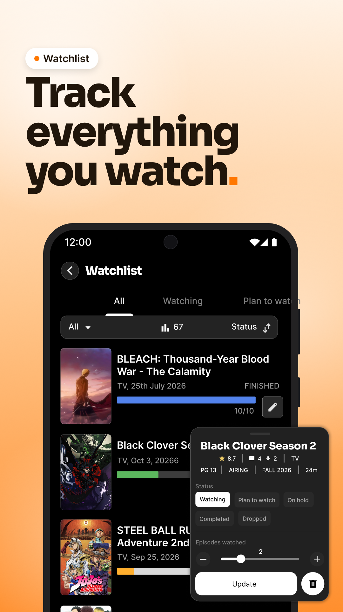
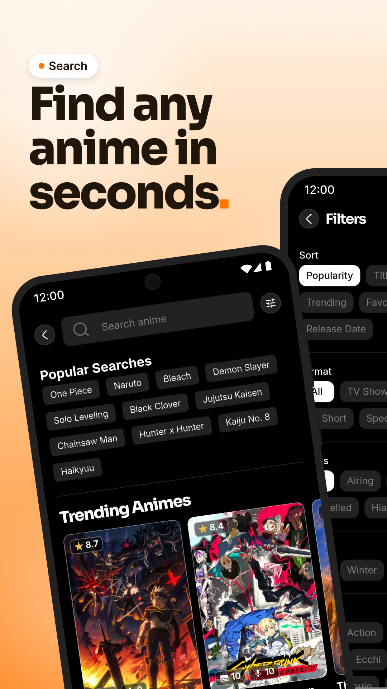
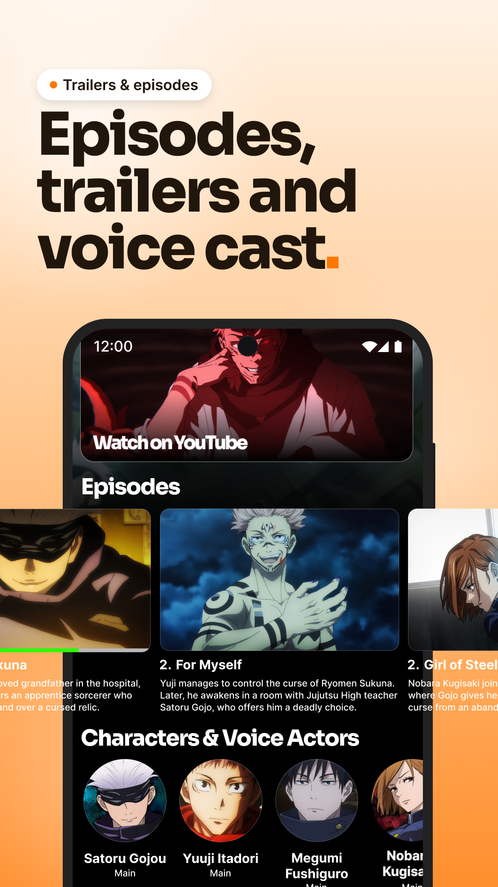
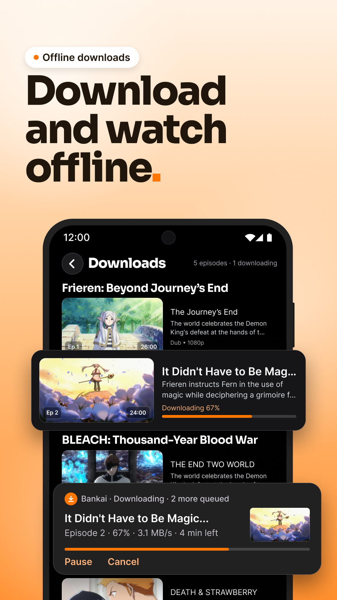

<div align="center">

# Bankai Streaming

**Stream, discover, and track anime from a library of 8,000+ titles — in both Subbed and Dubbed formats.**

[](https://flutter.dev)
[](https://dart.dev)
[](#getting-started)

</div>

---

## Overview

**Bankai Streaming** is an anime streaming and discovery application designed to deliver a fast, modern, and personalized viewing experience. Explore and stream the latest simulcasts and all-time classics from a collection of **8,000+ anime titles** in both **Sub** and **Dub**, stay ahead with **daily live airing schedules**, sign in securely with **OAuth**, and keep your **watchlist and favourites** synced to your account.

---

## App Preview

<div align="center">
<table>
  <tr>
    <td align="center" width="25%">
      
      <br />
      <sub><b>Airing Now</b></sub>
    </td>
    <td align="center" width="25%">
      
      <br />
      <sub><b>Sub &amp; Dub Streaming</b></sub>
    </td>
    <td align="center" width="25%">
      
      <br />
      <sub><b>Continue Watching</b></sub>
    </td>
    <td align="center" width="25%">
      
      <br />
      <sub><b>Daily Live Schedule</b></sub>
    </td>
  </tr>
  <tr>
    <td align="center" width="25%">
      
      <br />
      <sub><b>Watchlist &amp; Favourites</b></sub>
    </td>
    <td align="center" width="25%">
      
      <br />
      <sub><b>Search &amp; Filters</b></sub>
    </td>
    <td align="center" width="25%">
      
      <br />
      <sub><b>Episodes, Trailers &amp; Cast</b></sub>
    </td>
    <td align="center" width="25%">
      
      <br />
      <sub><b>Offline Downloads</b></sub>
    </td>
  </tr>
</table>
</div>

---

## Key Features

- **8,000+ Anime Library (Sub & Dub)**  
  Stream the latest airing episodes and classic series from a growing catalog of over 8,000 titles, with instant **Subbed / Dubbed** language switching and multiple streaming server options.
- **Daily Live Episode Schedule**  
  Get daily live updates of upcoming episodes with exact airing times, weekly calendar navigation, and real-time countdown timers so you never miss a new release.
- **Complete OAuth Authentication**  
  Secure, seamless account sign-in powered by **OAuth**, enabling personalized profiles and synced preferences per user.
- **Per-User Watchlist & Favourites Management**  
  Organize everything you watch by status (*Watching*, *Plan to Watch*, *On Hold*, *Completed*, *Dropped*), track episode progress with interactive controls, sort/filter your library, and curate your personal favourites list.
- **Continue Watching**  
  Automatically tracks playback progress across episodes so you can pick up right where you left off.
- **Offline Downloads**  
  Download episodes for offline viewing with queue management, live download speeds, ETA indicators, and pause/cancel controls.
- **Instant Search & Advanced Discovery**  
  Find any anime in seconds with popular search tags, trending showcases, and granular filtering by sort order (*Popularity*, *Trending*, *Favourites*, *Release Date*, *Title*), format, airing status, season, and genre.
- **Episodes, Official Trailers & Voice Cast**  
  Watch official trailers via embedded YouTube playback, read episode synopses and community reviews, and explore character profiles and voice actors.
- **Customizable UI & Themes**  
  Switch between dark and light themes, personalize accent colors, and tailor layout preferences for a clean viewing experience.

---

## Tech Stack

| Category | Technology |
| --- | --- |
| **Framework** | [Flutter](https://flutter.dev) (Dart `>=3.4.4 <4.0.0`) |
| **State Management** | `provider` |
| **Local Storage** | `hive` |
| **Networking & Data** | `http`, Jikan API v4 |
| **Media & UI** | `youtube_player_flutter`, `carousel_slider`, `hugeicons`, `intl` |

---

## Getting Started

### Prerequisites

- [Flutter SDK](https://docs.flutter.dev/get-started/install) (`>=3.4.4`)
- Dart SDK (bundled with Flutter)
- Android Studio, Xcode, or VS Code with Flutter extensions

### Installation

```bash
# 1. Clone the repository
git clone https://github.com/bankai-streaming/anime-app-bankai.git
cd anime-app-bankai

# 2. Install dependencies
flutter pub get

# 3. Run the application
flutter run
```

---

## Project Structure

```text
anime-app-bankai/
├── lib/
│   ├── main.dart            # Application entry point
│   ├── functionality/       # App state (Provider) & configuration data
│   ├── models/              # Anime, character, review, and user data models
│   ├── pages/               # Home, search, details, trailers, watchlist, account & settings screens
│   ├── services/            # API services & HTTP helpers
│   ├── theme/               # Dark & light theme definitions
│   └── utilities/           # Reusable UI components & widgets
├── mockups/                 # Application showcase mockups
├── android/                 # Android platform configuration
├── ios/                     # iOS platform configuration
├── web/                     # Web platform configuration
├── linux/                   # Linux desktop configuration
├── macos/                   # macOS desktop configuration
└── windows/                 # Windows desktop configuration
```

---

## Contributing

Contributions, feature requests, and bug reports are welcome! Feel free to open an issue or submit a pull request.

1. Fork the repository
2. Create your feature branch (`git checkout -b feature/your-feature`)
3. Commit your changes (`git commit -m "Add your feature"`)
4. Push to the branch (`git push origin feature/your-feature`)
5. Open a Pull Request
